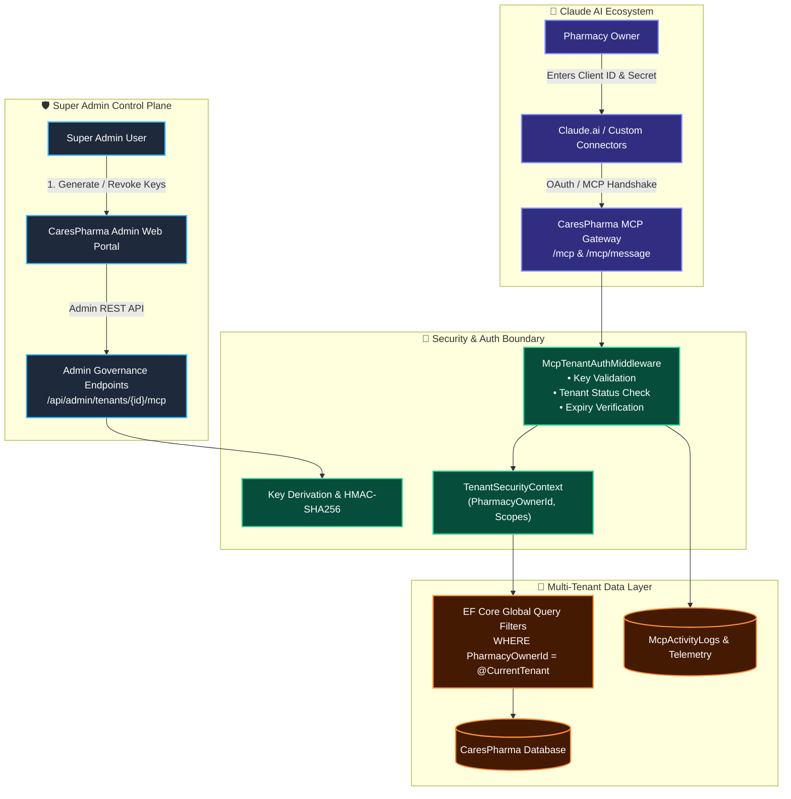
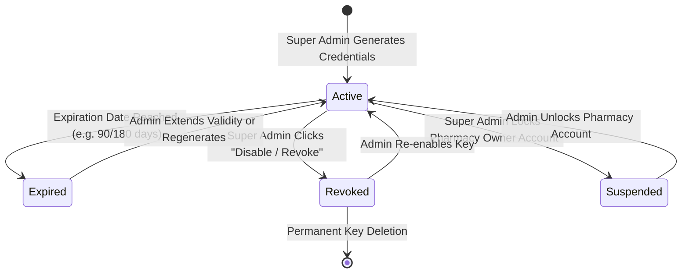

# CaresPharma Multi-Tenant MCP Integration Architecture
## Enterprise Client Credentials & Governance Workflow

> [!NOTE]
> **Executive Summary for Senior Leadership & Architects**  
> This document details the end-to-end architecture transitioning CaresPharma from ephemeral session-based tokens to **Tenant-Scoped Client Credentials (OAuth 2.0 / MCP Client ID & Secret)**. This guarantees strict multi-tenant data isolation, administrative governance, real-time telemetry, and instant kill-switch capabilities.

---

## 1. High-Level System Architecture & Trust Boundaries



---

## 2. End-to-End Workflow Diagram

```mermaid
sequenceDiagram
    autonumber
    actor Admin as 👨‍💼 Super Admin
    actor Owner as 👨‍⚕️ Pharmacy Owner
    participant Portal as 💻 Admin Portal (UI)
    participant Backend as ⚙️ CaresPharma Insights API
    participant Claude as 🤖 Claude.ai Connector
    participant DB as 🗄️ Multi-Tenant Database

    %% Step 1: Provisioning
    rect rgb(20, 30, 45)
    Note over Admin, Backend: Phase 1: Super Admin Credential Provisioning
    Admin->>Portal: Clicks "Generate MCP Credentials" on Pharmacy Owner
    Portal->>Backend: POST /api/admin/tenants/{ownerId}/mcp/generate (Expiry: 180d)
    Backend->>Backend: Generate ClientId (cp_live_...) & Secret (cp_sec_...)
    Backend->>Backend: Compute SHA-256 Hash of Secret + Unique Salt
    Backend->>DB: INSERT TenantMcpClients (ClientId, Salt, Hash, OwnerId, IsActive=1)
    Backend-->>Portal: Returns ClientId & Plain Secret (1-Time View)
    Portal-->>Admin: Displays Credential Modal (One-Time Copy)
    Admin->>Owner: Securely hands over Client ID & Client Secret
    end

    %% Step 2: Connection
    rect rgb(20, 45, 30)
    Note over Owner, Claude: Phase 2: Claude.ai Connector Setup
    Owner->>Claude: Settings -> Connectors -> "Use your own OAuth client"
    Owner->>Claude: Enters Client ID & Secret + CaresPharma MCP URL
    Claude->>Backend: GET /mcp (Handshake with Client Credentials)
    Backend->>Backend: Validate Key Hash + Verify Tenant.IsActive == true
    Backend->>DB: Log Connection in McpActivityLogs
    Backend-->>Claude: 200 OK (SSE Stream Established & Tools Published)
    end

    %% Step 3: Isolated AI Interaction
    rect rgb(35, 25, 45)
    Note over Owner, DB: Phase 3: Isolated AI Query Execution
    Owner->>Claude: "Give me medicines expiring within 30 days"
    Claude->>Backend: POST /mcp/message (tool: get_expiring_medicines)
    Backend->>Backend: Extract PharmacyOwnerId from TenantSecurityContext
    Backend->>DB: SELECT * FROM Medicines WHERE PharmacyOwnerId = @OwnerId AND ExpiryDate <= +30d
    DB-->>Backend: Return isolated pharmacy medicine records
    Backend-->>Claude: JSON-RPC Result (Sanitized & Isolated)
    Claude-->>Owner: Displays clean answer inside chat window
    end

    %% Step 4: Governance & Revocation
    rect rgb(50, 20, 20)
    Note over Admin, Claude: Phase 4: Instant Governance & Kill-Switch
    Admin->>Portal: Clicks "Lock Account" or "Disable MCP"
    Portal->>Backend: POST /api/admin/tenants/{ownerId}/mcp/revoke
    Backend->>DB: UPDATE TenantMcpClients SET IsActive = 0
    Backend->>Backend: Force-terminate active SSE sessions for Tenant
    Claude->>Backend: Next query or heartbeat ping
    Backend-->>Claude: 401 Unauthorized / Tenant Suspended
    Claude-->>Owner: "Connector authorization revoked by system administrator"
    end
```



---

## 3. Core Architectural Pillar Breakdown

### Pillar 1: Strict Data Isolation (Zero Cross-Tenant Leakage)
| Component | Implementation Mechanism | Guarantee |
| :--- | :--- | :--- |
| **Token-to-Tenant Binding** | `ClientId` points directly to an immutable `PharmacyOwnerId` in DB. | An AI request cannot specify or tamper with tenant identity. |
| **Data Access Layer** | Entity Framework Core **Global Query Filters** (`HasQueryFilter`). | Every SQL query automatically appends `WHERE PharmacyOwnerId = @tenantId`. |
| **In-Memory Boundary** | Each MCP session creates an isolated scoped container. | State, tool calls, and LLM context remain completely segregated. |

---

### Pillar 2: Security & Key Validation
```
[Client Input] -> Client ID + Secret 
        │
        ▼
[HMAC SHA-256 + Salt] ───> Fixed-Time Constant Comparison ───> [No Timing Attack]
        │
        ▼
[Tenant Status Verification] ───> (Owner.IsActive && McpKey.IsActive && !IsExpired)
        │
  ┌─────┴────────────────┐
  │ Pass                 │ Fail
  ▼                      ▼
Inject TenantContext   401/403 Reject & Audit Alert
```
* **Storage Security**: Secrets are **never** stored in plain text. Only high-entropy cryptographic hashes with per-tenant salts are persisted.
* **Visibility**: The secret is displayed **only once** upon creation. If lost, it must be regenerated.

---

### Pillar 3: Expiry, Governance & Kill-Switch Lifecycle



* **Instant Revocation**: When an owner is marked inactive, running Server-Sent Events (SSE) connections are forcefully closed immediately.
* **Heartbeat Invalidation**: Claude reconnect attempts are immediately rejected at the auth gateway without touching business logic.

---

### Pillar 4: Real-time Telemetry & Auditing
Super Admin has complete visibility over AI usage across all pharmacies:

```
┌────────────────────────────────────────────────────────────────────────────────────────┐
│ 📊 Super Admin - Live MCP Activity & Telemetry Dashboard                               │
├────────────────────┬─────────────────────┬──────────────┬──────────────┬───────────────┤
│ Pharmacy Owner     │ Client ID           │ Active State │ Last Active  │ Tool Calls    │
├────────────────────┼─────────────────────┼──────────────┼──────────────┼───────────────┤
│ Balvinder Singh    │ cp_live_cid_8f92... │ 🟢 Connected │ 2 mins ago   │ 142 calls     │
│ Manish Kumar       │ cp_live_cid_1a4c... │ 🟢 Connected │ Just now     │ 89 calls      │
│ Shreyansh Shekhar  │ cp_live_cid_4c78... │ 🔴 Disabled  │ 3 days ago   │ 0 calls       │
│ Mantu Kumar Shah   │ cp_live_cid_e220... │ ⚪ Idle      │ 5 hours ago  │ 12 calls      │
└────────────────────┴─────────────────────┴──────────────┴──────────────┴───────────────┘
```
Logs record: **Caller IP, Timestamp, Latency, Tool Name (e.g., `get_sales`), Success/Error Code**.

---

## 4. Claude Link Sharing Risk & Safety Analysis

> [!IMPORTANT]
> **What happens if someone opens a Claude chat link on another PC?**
> 1. **Public Chat Share**: Anthropic Claude renders public shared links as **static, read-only web snapshots**. Third parties **cannot** execute backend MCP tools from a shared chat link.
> 2. **Account Login on Another Device**: If a pharmacy owner logs into their Claude account from another PC, their configured connector calls the backend using the same Client ID.
> 3. **Kill Switch Impact**: If the Super Admin clicks **"Revoke"** or **"Lock Account"**, any further queries from ANY machine or user will instantly fail with `401 Unauthorized`.

---

## 5. Implementation Roadmap for Dev Team

1. **Phase 1: DB & Entities**
   - Create `TenantMcpClient` and `TenantMcpActivityLog` tables with migration scripts.
2. **Phase 2: Authentication Core**
   - Implement `ITenantMcpAuthService` with secure hashing, key generation, and validation.
   - Refactor `/mcp` and `/mcp/message` to validate client credentials.
3. **Phase 3: Admin Management API**
   - Expose endpoints: `Generate`, `Revoke`, `Toggle`, and `AuditLogs`.
4. **Phase 4: Admin Portal UI**
   - Add modal in **Pharmacy Owners** grid with copy buttons, expiry selector, and active toggle.
