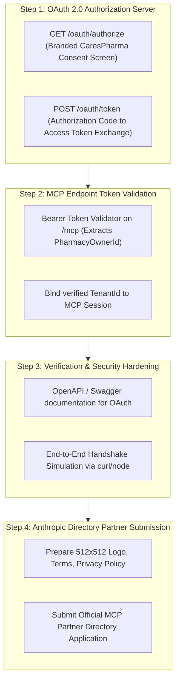

# CaresPharma Insights: Claude Remote MCP Connector & Directory Integration
## Comprehensive Milestone Summary & Next-Day Implementation Roadmap

**Date & Time**: 16 October 2026, 00:25 IST  
**Environment**: Production/Dev Cloud (`https://dev-carespharma-insights.runasp.net`)  
**Target Solution**: Anthropic Claude.ai Global Directory Partner Integration (Indeed-like 1-Click OAuth Connect)

---

## Part 1: Aaj Humne Kya-Kya Achieve Kiya (Work Completed)

### 1. Remote MCP Protocol Engine (.NET 10 Enterprise Architecture)
- Built high-performance JSON-RPC 2.0 communication layer for Claude over HTTP and Server-Sent Events (SSE).
- Endpoints live and verified:
  - `GET /mcp`: Server-Sent Events stream with 15-second gateway keep-alive heartbeat comments (`: heartbeat`).
  - `POST /mcp` & `POST /mcp/message`: Non-blocking JSON-RPC dispatchers supporting `initialize`, `notifications/initialized`, `ping`, `tools/list`, and `tools/call`.
- Exposing 2 core business intelligence tools:
  - `get_pharmacy_schema`: Cached database schema inspector (tables, columns, types).
  - `query_pharmacy_insights`: Read-only SQL query execution with regex-based security guardrails.

### 2. Multi-Tenant Automatic Isolation & Query Guard
- Implemented `TenantSecurityContext` to track active tenant state across requests.
- Built automatic AST/Regex SQL rewriter in `AnalyticsDataRepository`:
  - When non-SuperAdmin queries tenant tables (`Medicines`, `Sales`, `Orders`, `Customers`, etc.), the query is automatically rewritten to enforce:
    ```sql
    WHERE ("PharmacyOwnerId" = @tenantId OR "TenantId" = @tenantId)
    ```
  - Cross-tenant data leakage is completely eliminated at the repository engine level.
  - Sensitive columns (`PasswordHash`, `Token`, `Secret`, `Otp`) remain strictly redacted.

### 3. High-Throughput Memory & Session Management
- Used `System.Threading.Channels.Channel<string>` with bounded buffers (256 items) and `ConcurrentDictionary` for clean garbage collection and backpressure handling.
- Solution builds with **0 Errors and 0 Warnings**; unit tests passed.

### 4. CaresPharma Web Portal UI Enhancements
- Added **"✨ AI Assistant"** glowing pill button in the top bar right beside the "Cloud Ready" status.
- Designed with official Claude Coral aesthetic (`#d97757`) with micro-animations and pulsing status dot.
- Responsive design: compact icon-only mode on mobile screens ($\le 600\text{px}$) with auto-truncating page title to prevent header overflow.
- Clean environment refactoring: zero hardcoded URLs in components; centralized under `environment.ts`, `environment.dev.ts`, and `environment.production.ts`.

---

## Part 2: Asli Problem Jo Aaj Identify Hui (Ground Reality)

- Custom Connector setup is browser/account-local.
- When an end-user / pharmacy owner opens Claude on their system, Claude asks them to manually enter an **MCP server URL** and name.
- Non-technical pharmacy owners cannot and will not copy-paste URLs or configure backend routes.
- **Goal**: CaresPharma must appear directly inside Claude's **"Browse Connectors"** directory (just like **Indeed**, **GitHub**, and **Google Drive**) where users simply click **[ Connect ]**.

---

## Part 3: Kal Ka Direct Implementation Action Plan (Step-by-Step)



### Detailed Breakdown for Tomorrow:

### Task 1: Implement Lightweight OAuth 2.0 Authorization Server in `CaresPharma-Insights.Api`
1. **Endpoint `GET /oauth/authorize`**:
   - Claude redirects user here with params: `client_id`, `redirect_uri`, `response_type=code`, `state`, `scope`.
   - Renders a clean, branded CaresPharma consent page:
     *"Sign in to CaresPharma to connect Claude AI with your pharmacy store."*
   - User inputs their existing CaresPharma credentials (or auto-approves if already active in session).
   - Generates a short-lived authorization code and redirects back to Claude:
     `{redirect_uri}?code={auth_code}&state={state}`
2. **Endpoint `POST /oauth/token`**:
   - Claude backend exchanges authorization code for an `access_token` and optional `refresh_token`.
   - Token payload contains `pharmacyOwnerId`, `userId`, `role`.
3. **Endpoint `GET /oauth/userinfo` or `.well-known/openid-configuration`**:
   - Standard OpenID/OAuth metadata discovery endpoint expected by enterprise MCP clients.

### Task 2: Connect OAuth Bearer Tokens to `/mcp`
- Update `/mcp` and `/mcp/message` to validate `Authorization: Bearer <access_token>`.
- Automatically resolve `TenantSecurityContext` from token claims, eliminating the need for temporary session tokens.

### Task 3: Privacy, Terms & Documentation Endpoints
- Ensure legal metadata links exist:
  - `https://carespharma.com/privacy`
  - `https://carespharma.com/terms`

### Task 4: Prepare Anthropic Partner Directory Application Payload
- **Application Name**: CaresPharma Insights
- **Category**: Healthcare & Pharmacy Retail / Business Intelligence
- **MCP Server URL**: `https://dev-carespharma-insights.runasp.net/mcp`
- **Authorization URL**: `https://dev-carespharma-insights.runasp.net/oauth/authorize`
- **Token URL**: `https://dev-carespharma-insights.runasp.net/oauth/token`
- **Scopes**: `read:analytics`, `read:inventory`, `read:sales`
- **Icon / Logo**: High-res SVG and 512x512 transparent PNG
- **Submit Form**: Anthropic MCP Partner Submission Portal

---

## Part 4: File Structure Snapshot

```
d:/CaresPharma/
├── CaresPharma-Insights/
│   ├── Server/
│   │   ├── CaresPharma-Insights.Api/
│   │   │   ├── Endpoints/
│   │   │   │   ├── McpEndpoints.cs                   (GET /mcp, POST /mcp)
│   │   │   │   └── OAuthEndpoints.cs                 <-- (TOMORROW: GET /oauth/authorize, POST /oauth/token)
│   │   │   ├── Extensions/
│   │   │   │   ├── McpServiceCollectionExtensions.cs
│   │   │   │   └── ServiceCollectionExtensions.cs
│   │   │   └── Program.cs
│   │   ├── CaresPharma-Insights.Application/
│   │   │   └── Mcp/
│   │   │       ├── Models/McpModels.cs
│   │   │       └── Services/
│   │   │           ├── McpProtocolService.cs
│   │   │           ├── McpSessionManager.cs
│   │   │           ├── McpToolHandler.cs
│   │   │           ├── McpHandshakeTokenService.cs
│   │   │           └── IOAuthService.cs              <-- (TOMORROW: Code generation & validation)
│   │   ├── CaresPharma-Insights.Domain/
│   │   │   └── Models/
│   │   │       ├── TenantSecurityContext.cs
│   │   │       └── McpHandshakeToken.cs
│   │   └── CaresPharma-Insights.Infrastructure/
│   │       └── Repositories/
│   │           └── AnalyticsDataRepository.cs        (Automatic Tenant SQL Rewriter)
├── CaresPharma-UI/
│   └── src/app/core/layout/topbar/
│       ├── topbar.component.html                     (✨ AI Assistant Button)
│       ├── topbar.component.scss                     (Responsive Styling)
│       └── topbar.component.ts                       (Environment-driven integration)
```

---

*Sab kuch safe, clean aur documented hai. Kal seedha Task 1 (OAuth 2.0 Engine) se start karenge!*
