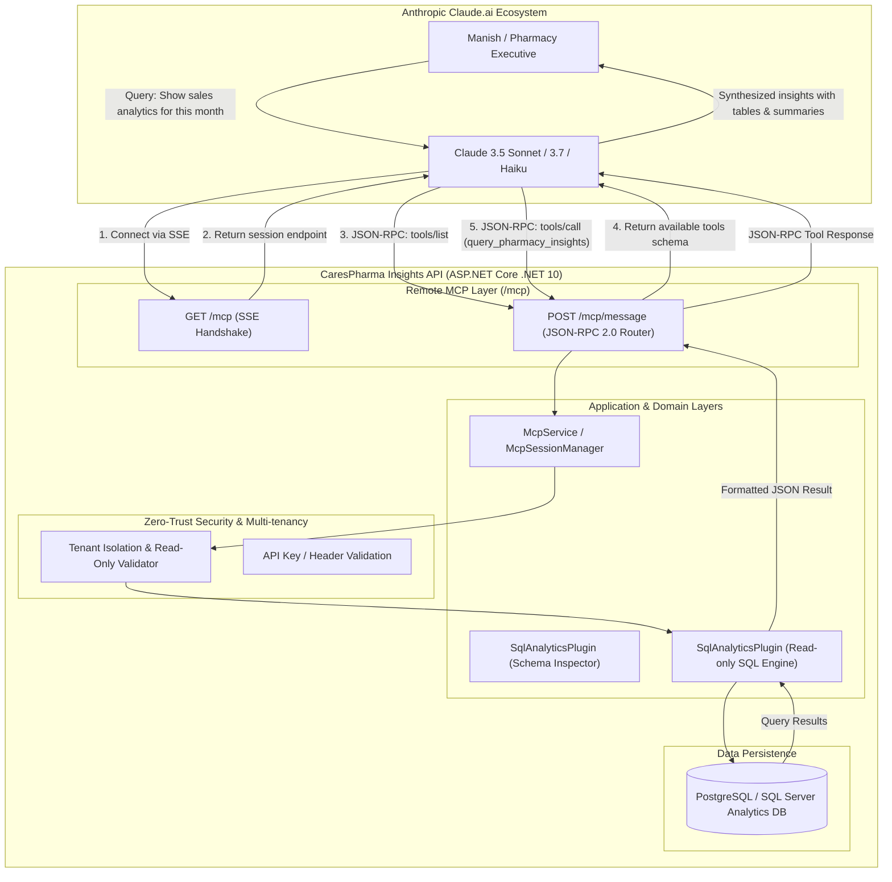

# CaresPharma Insights: Claude Remote MCP Connector Specification & Implementation Roadmap

## 1. Context & Motivation

CaresPharma Insights is an intelligent copilot and analytics API running on ASP.NET Core (.NET 10) hosted at `https://dev-carespharma-insights.runasp.net`.

### Key Architectural Decisions
1. **Chat UI Isolation**: The standalone web chat UI will not be exposed to general end-users. In the future, this chat capability will be integrated directly into the primary CaresPharma Web Portal navigation menu.
2. **Native Claude Workspace Integration**: We will expose CaresPharma Insights as a native **Custom Connector** directly within Anthropic's Claude.ai (similar to the official Indeed, Google Drive, and GitHub connectors).
3. **Preservation of Existing Infrastructure**: All existing REST endpoints (`/api/health`, `/api/chat`, `/api/conversations`), JWT authentication pipelines, and Semantic Kernel services must remain 100% intact, regression-free, and maintain clean enterprise architecture standards.

---

## 2. High-Level Architecture Overview

Claude.ai interacts with external data sources using the open **Model Context Protocol (MCP)** over **Server-Sent Events (SSE) and HTTP POST**.



---

## 3. Remote MCP Protocol Specifications (SSE Transport)

Anthropic Claude Custom Connectors operate using the **SSE Transport** defined by the MCP specification:

### 3.1 Connection Handshake (`GET /mcp`)
- Claude initiates a persistent HTTP `GET` connection with header:
  `Accept: text/event-stream`
- The server generates a unique `sessionId` (e.g. `Guid`) and registers the active SSE connection.
- The server sends the initial SSE event containing the callback URI where Claude can post messages:
  ```http
  HTTP/1.1 200 OK
  Content-Type: text/event-stream
  Cache-Control: no-cache
  Connection: keep-alive

  event: endpoint
  data: /mcp/message?sessionId=b8c1998e-4a67-4279-b1d5-e9dfca32a870
  ```

### 3.2 Client Request Processing (`POST /mcp/message?sessionId={guid}`)
All communication from Claude to CaresPharma is executed via standard JSON-RPC 2.0 payloads:

#### Step 1: Protocol Initialization (`initialize`)
- **Claude Request:**
  ```json
  {
    "jsonrpc": "2.0",
    "id": 1,
    "method": "initialize",
    "params": {
      "protocolVersion": "2024-11-05",
      "capabilities": { "roots": { "listChanged": true } },
      "clientInfo": { "name": "claude-web", "version": "1.0.0" }
    }
  }
  ```
- **CaresPharma Response:**
  ```json
  {
    "jsonrpc": "2.0",
    "id": 1,
    "result": {
      "protocolVersion": "2024-11-05",
      "capabilities": {
        "tools": { "listChanged": false },
        "resources": {}
      },
      "serverInfo": {
        "name": "CaresPharma-Insights",
        "version": "1.0.0"
      }
    }
  }
  ```

#### Step 2: Handshake Acknowledgment (`notifications/initialized`)
- **Claude Notification:**
  ```json
  {
    "jsonrpc": "2.0",
    "method": "notifications/initialized"
  }
  ```
- Handled silently; session state is marked active.

#### Step 3: Tool Discovery (`tools/list`)
- **Claude Request:**
  ```json
  {
    "jsonrpc": "2.0",
    "id": 2,
    "method": "tools/list"
  }
  ```
- **CaresPharma Response:**
  Returns metadata and JSON Schema for CaresPharma tools (see Section 4).

#### Step 4: Tool Execution (`tools/call`)
- **Claude Request:**
  ```json
  {
    "jsonrpc": "2.0",
    "id": 3,
    "method": "tools/call",
    "params": {
      "name": "query_pharmacy_insights",
      "arguments": {
        "sqlQuery": "SELECT MedicineName, SUM(Quantity) AS TotalQty, SUM(TotalPrice) AS TotalSales FROM Sales GROUP BY MedicineName ORDER BY TotalSales DESC LIMIT 5;"
      }
    }
  }
  ```
- **CaresPharma Response:**
  ```json
  {
    "jsonrpc": "2.0",
    "id": 3,
    "result": {
      "content": [
        {
          "type": "text",
          "text": "[{\"MedicineName\":\"Paracetamol 650mg\",\"TotalQty\":340,\"TotalSales\":5100.00}, ...]"
        }
      ],
      "isError": false
    }
  }
  ```

---

## 4. Tools Exposed to Claude

To empower Claude to act as an intelligent business analyst for CaresPharma, we will register two fundamental tools:

| Tool Name | Purpose | Parameters | Returns |
| :--- | :--- | :--- | :--- |
| **`get_pharmacy_schema`** | Provides Claude with tables, columns, and relationship descriptions so it writes accurate queries. | None | Complete database schema structure in JSON/Markdown. |
| **`query_pharmacy_insights`** | Executes read-only SQL queries to answer complex analytical questions (sales trends, dead stock, revenue, top customers). | `sqlQuery` (string, required): The read-only SQL SELECT query. | JSON array of record rows (capped at 50 rows per call). |

---

## 5. Security & Multi-Tenancy Architecture

Because this endpoint interfaces with Anthropic's cloud:
1. **Strict Read-Only Enforcement**:
   - The query executor enforces regex verification blocking `INSERT`, `UPDATE`, `DELETE`, `DROP`, `ALTER`, `TRUNCATE`, `EXEC`, and `CREATE`.
   - Only `SELECT` statements are permitted.
2. **API Key / Secret Token Header Support**:
   - Claude custom connectors support custom headers or query tokens (e.g. `/mcp?token=xyz` or `X-API-KEY: xyz`).
   - Requests without a valid key can be rejected immediately with `401 Unauthorized`.
3. **CORS Configuration**:
   - The `/mcp` endpoints will support CORS requests from Anthropic origins (`https://claude.ai`).

---

## 6. Implementation Plan & File Organization

The implementation will adhere to Clean Architecture standards across existing projects:

```
CaresPharma-Insights/
├── Server/
│   ├── CaresPharma-Insights.Api/
│   │   ├── Extensions/
│   │   │   └── McpServiceCollectionExtensions.cs    <-- Register MCP services and options
│   │   ├── Endpoints/
│   │   │   └── McpEndpoints.cs                      <-- Maps GET /mcp and POST /mcp/message
│   │   └── Program.cs                               <-- Register .AddMcpServer() and .MapMcpEndpoints()
│   │
│   ├── CaresPharma-Insights.Application/
│   │   ├── Mcp/
│   │   │   ├── Models/                              <-- JSON-RPC DTOs (Request, Response, ToolDefinition)
│   │   │   ├── Services/
│   │   │   │   ├── IMcpSessionManager.cs            <-- Manages SSE client channels & session IDs
│   │   │   │   ├── McpSessionManager.cs
│   │   │   │   ├── IMcpToolHandler.cs               <-- Bridges MCP tools to SqlAnalyticsPlugin
│   │   │   │   └── McpToolHandler.cs
│   │   │   └── McpService.cs                        <-- Dispatches JSON-RPC methods (initialize, tools/list, etc.)
```

### Detailed Execution Steps:

#### Step 1: Create MCP Core Contracts & DTOs
- Create JSON-RPC 2.0 records (`McpJsonRpcRequest`, `McpJsonRpcResponse`, `McpTool`, `McpCallToolParams`).
- Ensure full compliance with System.Text.Json property naming policies (`camelCase`).

#### Step 2: Implement Session Manager & SSE Channel
- Implement in-memory thread-safe `McpSessionManager` using `System.Threading.Channels.Channel<string>` to stream events to Claude's SSE connection.

#### Step 3: Implement Tool Handlers
- Implement `McpToolHandler` that leverages the existing `IAnalyticsDataRepository` and `SqlAnalyticsPlugin`.
- Expose the exact JSON schema specifications for `get_pharmacy_schema` and `query_pharmacy_insights`.

#### Step 4: Map Minimal API Endpoints
- In `McpEndpoints.cs`, register:
  - `GET /mcp`: Sets SSE headers, keeps connection alive with periodic heartbeats/comments (`: heartbeat`), and transmits events.
  - `POST /mcp/message`: Ingests JSON-RPC requests from Claude, processes them asynchronously, and returns response payloads.

#### Step 5: Verification & Zero-Regression Validation
- Verify that `/api/health`, `/api/chat`, and `/api/conversations` operate normally.
- Build the entire solution using `dotnet build` with zero warnings or errors.

#### Step 6: Deployment & Claude Integration
- Commit and push to Git branch `dev`.
- Allow the GitHub Actions workflow (`dev-deploy.yml`) to deploy to `https://dev-carespharma-insights.runasp.net`.
- Add connector in Claude.ai under **Custom Connector**:
  - **Name**: `CaresPharma Insights`
  - **MCP server URL**: `https://dev-carespharma-insights.runasp.net/mcp`
- Test live queries from Claude!
