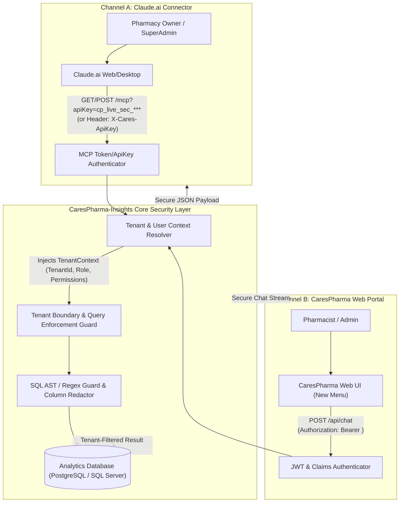
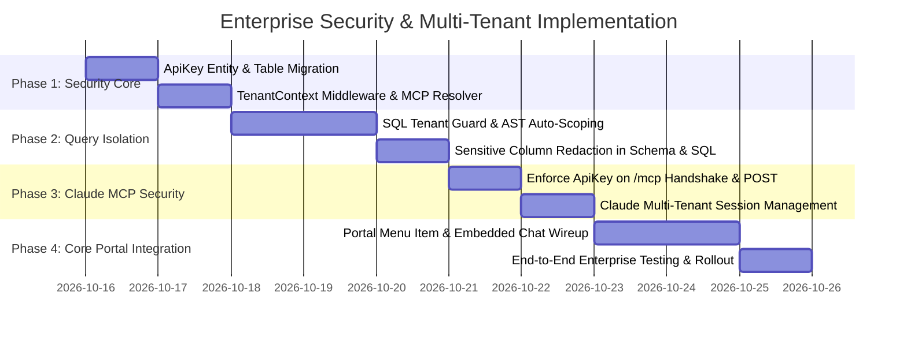

# Enterprise Multi-Tenant Security & Integration Architecture Plan
## CaresPharma Insights (Claude Custom Connector + Core Web Portal Menu)

---

## 1. Executive Summary & Problem Formulation

CaresPharma is a **multi-tenant pharmacy platform** where different Pharmacy Owners (Tenants), Branch Staff (Pharmacists, Cashiers), and SuperAdmins operate on the same system.

### Two Key Client Channels for AI Insights:
1. **Claude Remote MCP Connector (`https://claude.ai`)**:
   - Used by SuperAdmins or Pharmacy Owners inside their private Claude workspace.
   - **Challenge**: Anthropic servers send requests on behalf of users; the system must identify *who* is calling and *which tenant's data* they are permitted to view.
2. **CaresPharma Core Web Portal In-App Menu ("AI Insights / Copilot")**:
   - Used directly by logged-in users inside the CaresPharma dashboard.
   - **Challenge**: The frontend already possesses the user's JWT Bearer token; requests must automatically be scoped to their `PharmacyOwnerId` / `BranchId` with role-based access control (RBAC).

---

## 2. Multi-Tenant Zero-Trust Security Architecture



---

## 3. Core Enterprise Security Pillars

### Pillar 1: Multi-Tenant Query Isolation (Tenant Scoping)
Every pharmacy tenant has a unique identifier (e.g., `PharmacyOwnerId` or `TenantId`).
- **SuperAdmin Role**:
  - Full system visibility across all pharmacies, system health, and cross-tenant benchmarks.
- **Pharmacy Owner / Staff Role**:
  - **Strict Automatic Filtering**: Any analytical query that touches tenant-owned tables (`Medicines`, `Sales`, `Orders`, `Customers`, `Inventory`, `Prescriptions`) **must** include `WHERE PharmacyOwnerId = @tenantId`.
  - **Query AST Rewriter / SQL Guard**: If Claude attempts to run `SELECT * FROM Medicines;`, the security filter automatically transforms it into:
    ```sql
    SELECT * FROM "Medicines" WHERE "PharmacyOwnerId" = 'tenant_guid_123';
    ```
    This prevents data leakage across tenants, even if an AI prompt does not explicitly specify a tenant ID.

### Pillar 2: Authentication & Token Management for Claude MCP
Claude Custom Connectors communicate via HTTPS. To authenticate enterprise users without complex external OAuth:
1. **Tenant-Scoped API Keys**:
   - A Pharmacy Owner or SuperAdmin generates a dedicated API key from the CaresPharma Settings portal (e.g., `cp_live_ab81...`).
   - The key is cryptographically hashed (SHA-256) and mapped in the database to:
     - `TenantId` / `PharmacyOwnerId`
     - `CreatedByUserId`
     - `Role` (`PharmacyOwner` or `SuperAdmin`)
     - `ExpirationDate` & `RevocationStatus`
2. **Connecting to Claude**:
   - The URL provided to Claude includes the key or token:
     `https://dev-carespharma-insights.runasp.net/mcp?apiKey=cp_live_ab81...`
   - When Claude initiates the connection, the MCP endpoint validates the key, resolves the tenant context, and binds it to that Claude session.

### Pillar 3: Sensitive Data Redaction & Guardrails
- **PII & Credential Protection**: Columns such as `PasswordHash`, `Salt`, `Otp`, `Token`, `CreditCard`, `Ssn` are excluded both in the schema metadata (`get_pharmacy_schema`) and blocked in query execution.
- **Strict Read-Only Verification**: Rejection of any mutation statements (`INSERT`, `UPDATE`, `DELETE`, `DROP`, `ALTER`, `TRUNCATE`, `EXEC`).
- **Resource Protection (DDoS / Memory exhaustion)**: Automatic query timeouts (5 seconds) and hard row limits (`LIMIT 50`).

---

## 4. In-App Web Portal Menu Integration ("AI Insights / Copilot")

To integrate this feature directly into the primary CaresPharma Web Application:

1. **Navigation Menu Addition**:
   - Add a new menu item in the CaresPharma sidebar:
     ```
     📊 Analytics & Insights
        └── 🤖 CaresPharma AI Copilot (New)
     ```
2. **Seamless Embedded Chat Interface**:
   - The existing chat frontend (Blazor WASM / Web Component) connects directly to:
     `POST /api/chat`
   - It forwards the user's active session JWT token in the `Authorization: Bearer <token>` header.
3. **No Duplicate Infrastructure**:
   - The same backend repository (`AnalyticsDataRepository`), Semantic Kernel pipeline, and tenant guardrails serve both:
     - The internal Web Portal menu (`/api/chat`)
     - The external Claude Custom Connector (`/mcp`)

---

## 5. Detailed Step-by-Step Implementation Roadmap



### Phase 1: Tenant Context & API Key Infrastructure
- Create `ApiKey` entity in `Domain` with properties:
  - `Id` (Guid), `KeyHash` (string), `TenantId` (string), `UserId` (string), `Role` (string), `CreatedAt`, `IsRevoked`.
- Add `ITenantContextAccessor` to standardize retrieving `TenantId` and `UserRole` across both JWT (Web Portal) and API Key (Claude MCP) requests.

### Phase 2: Tenant-Aware SQL Guard
- Enhance `IAnalyticsDataRepository.ExecuteReadOnlyQueryAsync`:
  - When `Role != "SuperAdmin"`, detect whether queried tables contain `PharmacyOwnerId` / `TenantId`.
  - Automatically append tenant filters or reject queries attempting cross-tenant access.

### Phase 3: Claude MCP Endpoint Protection
- Update `McpEndpoints.cs`:
  - Read `apiKey` from query parameter (`/mcp?apiKey=...`) or `X-Cares-ApiKey` header.
  - Reject unauthorized clients with `401 Unauthorized` / JSON-RPC error `-32001 (Unauthorized)`.
  - Bind resolved `TenantContext` to the active MCP session ID.

### Phase 4: CaresPharma Web Portal Menu
- In the primary CaresPharma Web UI:
  - Add "AI Insights" in the navigation layout.
  - Embed the Copilot component with existing user JWT credentials.
  - Users ask questions in Hindi or English and receive answers scoped exclusively to their pharmacy.
